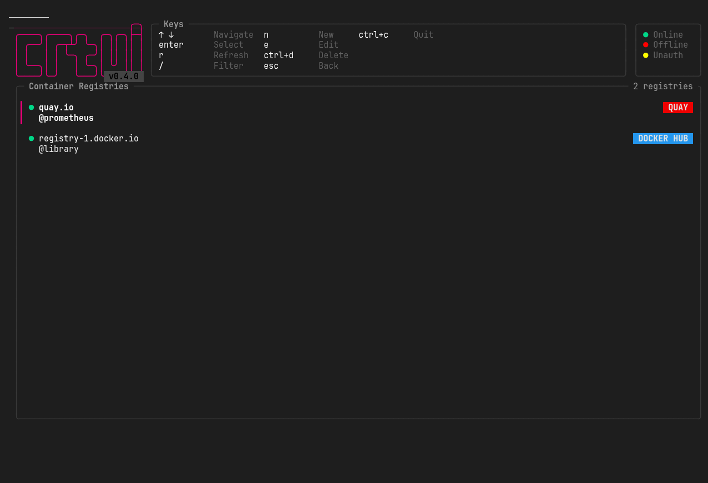
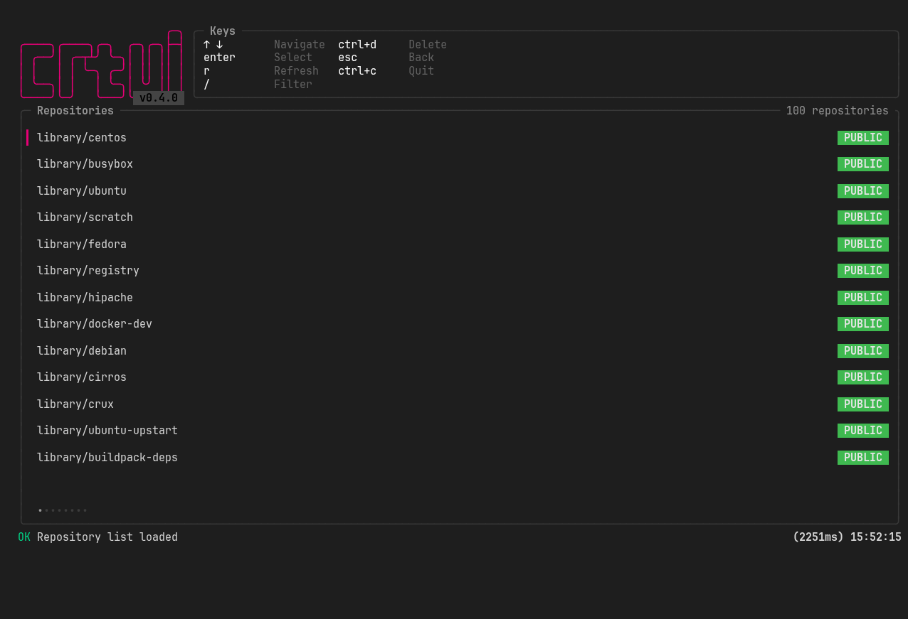
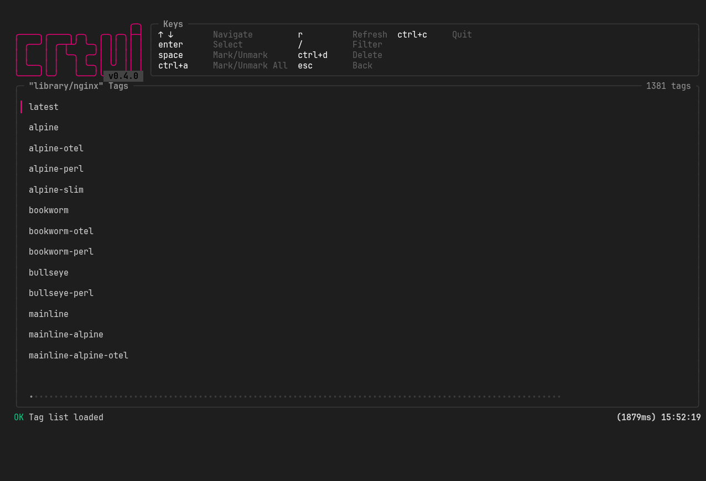
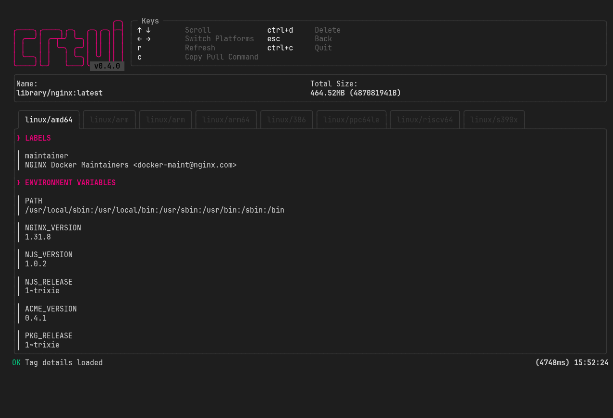
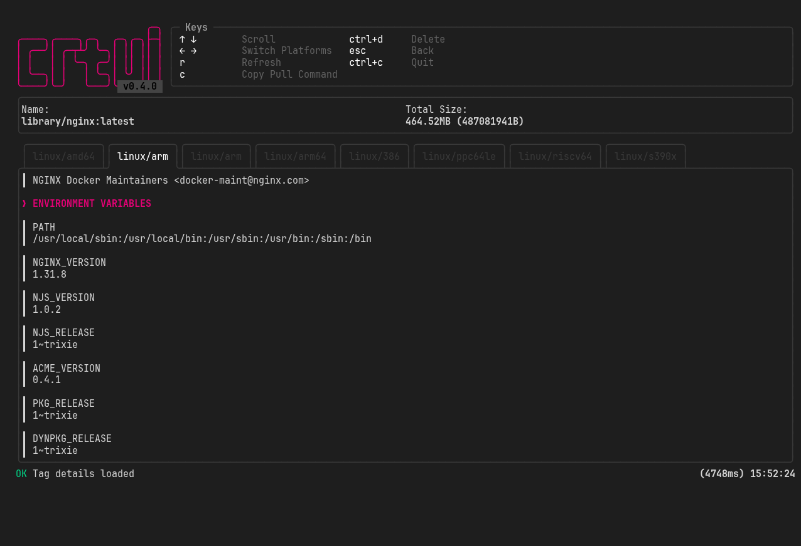
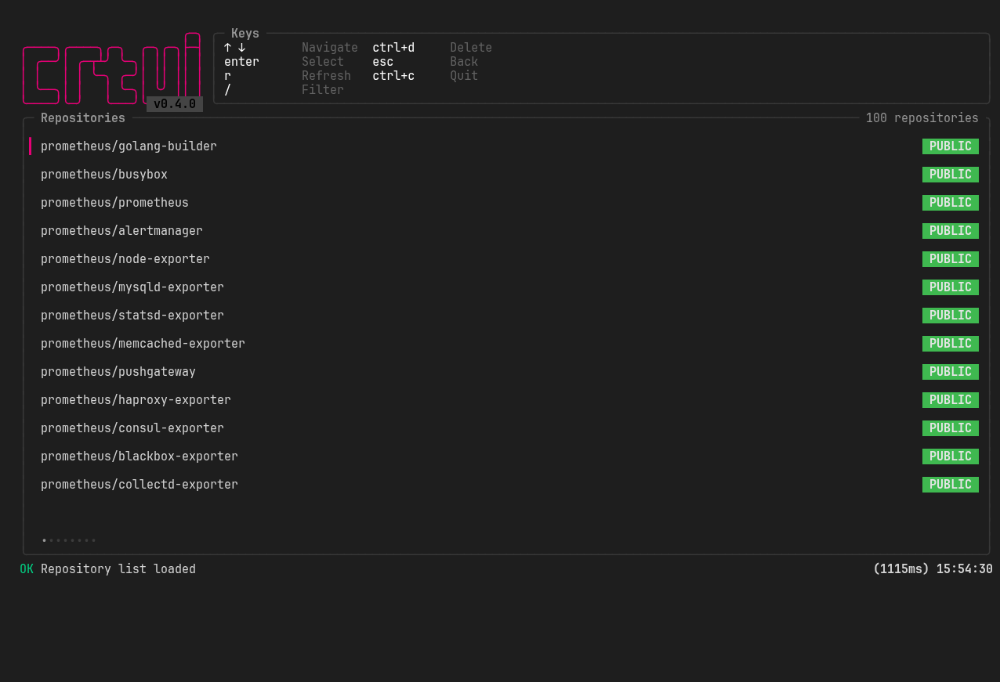

A terminal-based TUI tool for managing container registries (`registry:2`, Harbor, Quay, GitHub Container Registry / `ghcr.io`, and Docker Hub). Supports both Docker and Podman credentials.

## 📋 Table of Contents

- [Features](#features)
  - [Registry Management](#-registry-management)
  - [Repository \& Tag Management](#-repository--tag-management)
  - [Tag Details \& Inspection](#-tag-details--inspection)
  - [User Experience](#%EF%B8%8F-user-experience)
- [Supported Registries](#%F0%9F%97%82%EF%B8%8F-supported-registries)
- [Screenshots](#-screenshots)
- [Quick Start](#quick-start)
- [Installation](#installation)
  - [Homebrew](#homebrew-macoslinux)
  - [Debian](#debian-ubuntu-linux-mint)
  - [Fedora/RHEL](#fedorarhel)
  - [Alpine](#alpine-apk)
  - [AUR](#aur-arch-linux-cachyos-manjaro)
  - [Curl+Bash](#curlbash)
  - [Go Install](#go-install)
  - [Direct Download](#direct-download-prebuilt-binary)
- [Build From Source](#build-from-source)
- [License](#license)

## ✨ Features

### 📦 Registry Management
- **List Registries**: View all configured container registries with their connection status (online/offline/unauthorized)
- **Add Registry**: Create new registry connections with custom URL, username, and password credentials
- **Edit Registry**: Modify existing registry connection details
- **Delete Registry**: Remove registry connections from the configuration
- **Auto-detect Credentials**: Automatically discover and use Docker/Podman credentials from config files, including credentials stored through credential helpers such as `docker-credential-secretservice` (system keychain).
- **GitHub Container Registry (ghcr.io)**: Browse ghcr.io packages and repositories. Uses the OCI Bearer token auth flow automatically and lists packages through the GitHub API (a fine-grained token with `packages:read` / `read:packages` scope is required to list repositories). Enter the GitHub username/org as the username and the token as the password. Each package is marked with its `PUBLIC`/`PRIVATE` visibility.
- **Zot**: Self-hosted zot registries are detected automatically through their `/v2/_oci/ext/discover` endpoint and use the generic `/v2/_catalog` listing. Authentication is optional and follows zot's auth configuration (basic auth or API key).
- **Harbor**: Self-hosted Harbor instances are detected automatically (through their `/api/v2.0/ping` endpoint) and repositories are listed with the Harbor project API, so a system admin account is not needed. Public/private visibility comes from the project metadata. Username and password (or a robot account) are required.
- **Quay**: Browse `quay.io` repositories. Enter the namespace (user or organization) as the username and an OAuth token as the password. Without a token only public repositories are listed. Public/private visibility comes from the Quay API.
- **Docker Hub**: Browse Docker Hub image repositories. Docker Hub does not expose a registry catalog endpoint, so repositories are listed through the `hub.docker.com` API. Enter your Docker Hub username (namespace) as the username and a password or access token as the password. Without a password only public repositories are listed (up to Docker Hub's anonymous pagination limit); the Docker Hub entry from Docker/Podman credentials is auto-detected too. Each image is marked with its `PUBLIC`/`PRIVATE` visibility.

### 📂 Repository & Tag Management
- **Browse Repositories**: Navigate through all repositories in a selected registry
- **Search & Filter**: Instantly filter repositories and tags using the search input
- **View Tags**: Display all tags available in a selected repository
- **Delete Repository**: Remove all tags from a specific repository
- **Delete Tags**: Select and delete individual or multiple tags from a repository

### 🔍 Tag Details & Inspection
- **Multi-Platform Support**: View tags built for multiple architectures and operating systems (linux/amd64, linux/arm64, linux/arm/v7, windows/amd64, etc.)
- **Total Size**: See the complete disk size of the image including all layers
- **Environment Variables**: Inspect all defined environment variables passed to the container
- **Entrypoint**: View the container entrypoint command
- **CMD**: View the default command executed when the container starts
- **Working Directory**: See the configured working directory inside the container
- **User**: View the user/group that runs the container process
- **Layers**: Browse through all container image layers with their individual sizes
- **History**: View the complete build history including creation dates and author information
- **RootFS**: Inspect the root filesystem layers and their digests
- **Labels**: View OCI image labels and annotations

### ⌨️ User Experience
- **Copy Pull Command**: Copy the exact `docker pull` command to clipboard with a single keypress
- **Refresh Data**: Manually refresh registry, repository, or tag lists at any time
- **Status Feedback**: Real-time status messages showing success/error states and operation duration
- **Loading Indicators**: Visual spinners and progress indicators during data fetching operations

## 🗂️ Supported Registries

| Registry | Type | Repo listing | Auth |
| --- | --- | --- | --- |
| `registry:2` (self-hosted, generic Distribution) | generic | `/v2/_catalog` | Basic / Bearer token |
| GitHub Container Registry (`ghcr.io`) | OCI | GitHub API (`packages:read`) | GitHub token |
| Docker Hub (`docker.io`) | OCI | `hub.docker.com` API | username (+ optional token) |
| Harbor (self-hosted) | generic | Harbor API (`/api/v2.0`) — auto-detected | username + password / robot account |
| Quay (`quay.io`) | OCI | `quay.io` API | namespace (+ optional token) |
| Zot (self-hosted) | generic | `/v2/_catalog` — auto-detected | Basic / API key (optional) |

## 📸 Screenshots

| Screenshots | |
| --- | --- |
| <br>Registry list with per-type badges | <br>Docker Hub repositories with visibility |
| <br>Tags of `library/nginx` | <br>Platforms, labels and environment variables |
| <br>Switching between platforms | <br>Quay namespace repositories |

## 🚀 Quick Start

```bash
crtui
```

The application automatically detects existing Docker or Podman credentials and displays them in the registry list. Credentials kept in the system keychain via a credential helper (`docker-credential-*`, e.g. `secretservice`) are read transparently — they are never stored in plain text.

[](https://asciinema.org/a/ujo5faGGk8PPsBeM)

## 🛠️ Installation

### 🍺 Homebrew (macOS/Linux)
```bash
brew install ksckaan1/tap/crtui
```

### 🐧 Debian (Ubuntu, Linux Mint...)
1. Add repository
	```bash
	curl -1sLf \
	  'https://dl.cloudsmith.io/public/ksckaan1/crtui/setup.deb.sh' \
	  | sudo -E bash
	```

2. Install package
	```bash
	sudo apt update
	sudo apt install crtui
	```

### 🎩 Fedora/RHEL
1. Add repository
	```bash
	curl -1sLf \
	  'https://dl.cloudsmith.io/public/ksckaan1/crtui/setup.rpm.sh' \
	  | sudo -E bash
	```

2. Install package
	```bash
	sudo dnf update
	sudo dnf install crtui
	```

### 🏔️ Alpine (apk)
1. Add repository
	```bash
	sudo apk add --no-cache bash
	```
	```bash
	curl -1sLf \
	  'https://dl.cloudsmith.io/public/ksckaan1/crtui/setup.alpine.sh' \
	  | sudo -E bash
	```

2. Install package
	```bash
	sudo apk add crtui
	```

### 🐛 AUR (Arch Linux, CachyOS, Manjaro)
```bash
yay -S crtui-bin
```

### 🌐 Curl+Bash
```bash
curl -fSSL https://crtui.kaanksc.com/install | bash
```

### 🐹 Go Install
```bash
go install github.com/ksckaan1/crtui/cmd/crtui@latest
```

Make sure `$HOME/go/bin` (or `$GOPATH/bin`) is in your PATH.

### 📦 Direct Download Prebuilt Binary
Download from [Releases](https://github.com/ksckaan1/crtui/releases):
- **Linux**: `.tar.gz` (amd64, arm64)
- **macOS**: `.tar.gz` (amd64, arm64)
- **Windows**: `.zip` (amd64, arm64)

Extract and run:
```bash
tar -xzf crtui_*.tar.gz
./crtui
```

## 🔨 Build From Source

### Prerequisites
- Go 1.26+

### Build

```bash
git clone https://github.com/ksckaan1/crtui.git
cd crtui
go build -o crtui ./cmd/crtui
```

## 📄 License

MIT License
